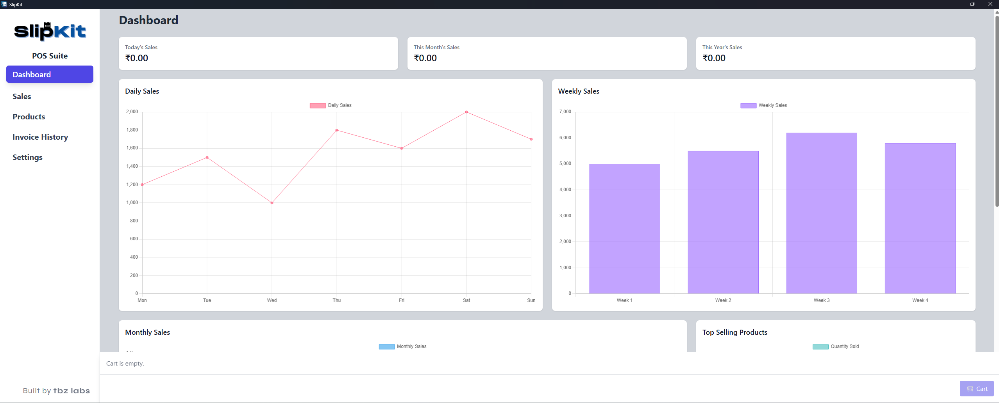
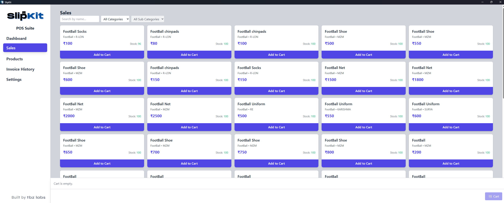

# SlipKit POS Suite

SlipKit POS Suite is a desktop-based Point of Sale (POS) application focused on modern retail and restaurant operations.

Built and actively maintained by TBZ Labs, the project aims to provide a clean, fast, and practical billing system with inventory handling, invoice management, analytics, and operational workflows.

---

## Overview

SlipKit is designed as a lightweight operational POS platform for small businesses, restaurants, and retail environments.

The project is under active development and continuously evolving with workflow improvements, reporting systems, licensing infrastructure, and business automation features.

---

## Features

* Desktop-based POS workflow
* Product and inventory management
* Sales dashboard with analytics
* Invoice history tracking
* Category and sub-category support
* Cart and billing workflow
* GST-ready billing architecture
* Barcode scanner integration
* Sales reporting and charts
* Modern card-based product browsing UI
* Real-time cart management
* Device-based license activation system
* Signed license payload verification
* Offline-ready desktop architecture

---

## Screenshots

### Dashboard



---

### Sales Screen



---

## Licensing System

SlipKit includes a custom licensing and activation workflow designed for controlled desktop deployments.

Current licensing architecture includes:

* Device-bound activation
* Signed license payload verification
* Plan-based activation system
* Offline validation support

Sensitive production infrastructure, signing keys, and deployment secrets are excluded from the public repository.

---

## Tech Stack

* Electron
* Node.js
* JavaScript
* SQLite
* HTML/CSS

---

## Project Structure

```bash
assets/               # UI assets and screenshots
styles/               # Styling files
tools/                # Internal utility tools
dist/                 # Production builds
db.js                 # Database layer
barcode-scanner.js    # Barcode integration
```

---

## Current Development Focus

* Better restaurant workflows
* Faster cart performance
* Enhanced invoice handling
* Improved inventory management
* Better GST calculations
* Operational automation features
* UI/UX refinement
* Reporting improvements

---

## Vision

SlipKit is part of a broader operational software ecosystem being developed under TBZ Labs, including:

* Restaurant operating systems
* Diagnostic lab management systems
* Business workflow automation tools

The long-term goal is to build practical software focused on real operational use-cases instead of bloated enterprise complexity.

---

## Installation

```bash
git clone https://github.com/tabz79/pos-desktop.git

cd pos-desktop

npm install

npm start
```

---

## Repository Notes

The public repository excludes:

* Production secrets
* Environment credentials
* Licensing keys
* Internal deployment infrastructure
* Customer-sensitive data

---

## Status

Active Development 🚧

This project is actively maintained and continuously improved.

---

## Maintainer

Built and maintained by Tabrez
TBZ Labs

---

## License

This repository is currently shared for open-source visibility, collaborative learning, and architectural reference.

License terms may evolve in future releases.
